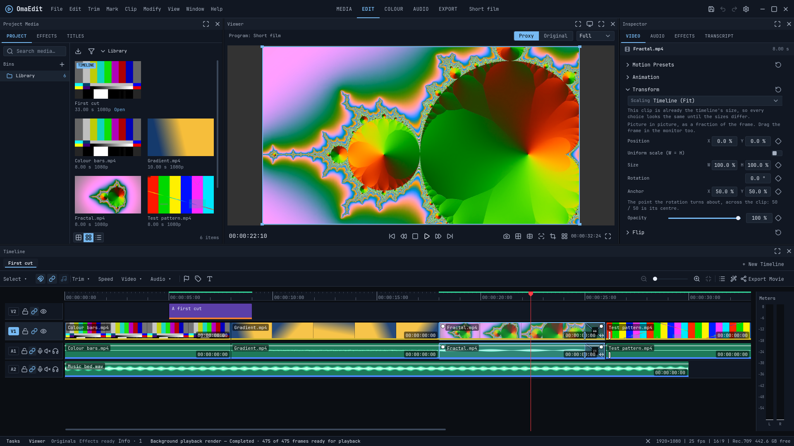

# OmaEdit

A video editor for [Omarchy](https://omarchy.org). Bring in your footage, cut it
on a multi-track timeline, correct its colour, mix its sound and deliver the
finished film, all in one app and mostly from the keyboard.



**First public test release · Omarchy and Arch Linux, x86_64.** Expect some rough
edges. Keep a copy of anything you cannot shoot again, and please
[report what you find](https://github.com/28allday/omaedit/issues).

## Install

You need one file: the package whose name ends in **`x86_64.pkg.tar.zst`**, on
the newest [release](https://github.com/28allday/omaedit/releases/latest).

**The quick way:** open a terminal (**Super+Enter** on Omarchy), paste this line,
press Enter and give your password. It downloads the package and installs it in
one go:

```sh
cd /tmp && curl -LO https://github.com/28allday/omaedit/releases/download/v0.2.4/omaedit-0.2.4-1-x86_64.pkg.tar.zst && sudo pacman -U omaedit-0.2.4-1-x86_64.pkg.tar.zst
```

**Or by hand:**

1. On the [newest release](https://github.com/28allday/omaedit/releases/latest),
   under **Assets**, download the file ending in `x86_64.pkg.tar.zst`. The other
   files (the source and the checksums) are not needed to install.
2. Open a terminal and install it:

   ```sh
   sudo pacman -U ~/Downloads/omaedit-*.pkg.tar.zst
   ```

3. Enter your password when asked and confirm the packages to install.

Then open **OmaEdit** from your application launcher (**Super+Space** on
Omarchy).

Everything it needs comes with the package or is installed with it from the
official repositories. You do not need to compile anything. If your system has
not been updated for a while, run `sudo pacman -Syu` first.

## Getting started

The window has five pages, named along the top: **Media**, **Edit**, **Colour**,
**Audio** and **Export**. It opens on Media, where footage comes in. The Edit
page has the library on the left, the viewer above and the timeline below.

To make your first cut:

1. Press **Ctrl+I** and choose some footage. It appears in the library. Then
   click **Edit** along the top.
2. Click a clip to see it in the viewer. Play with **Space**, or shuttle with
   **J**, **K** and **L**. Mark the part you want with **I** and **O**.
3. Press **E** to add it to the end of the timeline. The first time, OmaEdit asks
   what size and frame rate the timeline should have, and offers the clip's own.
4. Carry on: **W** inserts at the playhead and **D** overwrites. **Ctrl+B** cuts
   the clip under the playhead, **Backspace** removes a clip and leaves a gap,
   and **Shift+Backspace** closes the gap behind it.
5. Press **Ctrl+S** to save. A project is one `.omaedit` file; it points at your
   footage and never changes it.
6. Press **Ctrl+E** to export a film with the quick preset, or **Ctrl+Shift+E**
   to open the Export page and choose.

Press **?** in the app for every key, or rest the pointer on any control to see
what it does. The full [user guide](MANUAL.md) covers each page in detail, and
there is an illustrated guide with short films at
<https://www.omatools.org/omaedit/help/>.

## The five pages

- **Media** brings footage into the project and keeps it in order: drives
  (a drive you plug in can be mounted and ejected right there) and
  favourite folders, bins and saved searches, metadata, relinking, and proxies
  for footage too heavy to play as it is.
- **Edit** is the timeline: as many picture and sound tracks as you need,
  three-point editing, trimming, transitions, titles and captions, speed
  changes, picture effects, multicam and timelines inside timelines.
- **Colour** is for the colour work an edit needs: balance, contrast and
  saturation, curves, a look from a LUT, and corrections kept to part of the
  picture, with scopes beside the viewer. Colour is managed through
  OpenColorIO, with input settings for the common camera log formats.
- **Audio** is the mix: a channel strip for every track with effects, meters
  and a loudness meter, and the sound you hear is the sound the export carries.
- **Export** turns the cut into files: presets for masters, the web and social
  sites, broadcast and sound alone, checks before a render starts, and a queue
  that renders one job after another.

Timelines go to and from other applications as OpenTimelineIO, EDL and XML, and
as AAF when `python-aaf2` is installed.

## Command-line and agent use

OmaEdit also runs without a window. The same engine creates and inspects
projects, applies edits written as JSON and renders real files, for scripts and
for coding agents:

```sh
omaedit ops                                          # every operation it knows
omaedit new edit.omaedit --timeline Main             # a new project
omaedit apply edit.omaedit --ops edits.json --output revised.omaedit
omaedit export revised.omaedit --output film.mp4 --progress
```

`omaedit guide` prints the whole command-line manual, which is also
[here](docs-cli.md). The command line works on project files; it does not take
over a window you have open.

The package carries a skill that tells an agent how to use these commands. To
make it available to the agents installed for your user, run `omaedit skill
--link` once. `omaedit skill` shows where it is and what is linked. Installing
the package writes nothing into your home folder.

## Your projects and settings

| Where | What |
| --- | --- |
| Wherever you save them | Your projects (`.omaedit` files) |
| `~/.config/omaedit/` | Your settings, keyboard shortcuts and layouts |
| `~/.local/share/omaedit/` | Recovery copies, project backups, presets and saved stills |
| `~/.cache/omaedit/` | Thumbnails, waveforms and the playback cache, safe to delete |

While you work, OmaEdit keeps a recovery copy and offers it back after a crash
or a power cut. Each save keeps the previous version as a backup: see **File ▸
Recovery and Backups…**.

## Useful keys

| Key | Action |
| --- | --- |
| `?` | Every key |
| `Ctrl+I` / `Ctrl+O` / `Ctrl+S` | Import media / open a project / save |
| `Space`, `J` `K` `L` | Play or pause, shuttle back, stop and forward |
| `I` / `O` | Mark in / out |
| `E` `W` `D` | Append / insert / overwrite |
| `Ctrl+B` | Cut at the playhead |
| `Backspace` / `Shift+Backspace` | Delete leaving a gap / delete and close the gap |
| `Ctrl+T` | Cross dissolve |
| `Ctrl+Z` / `Ctrl+Shift+Z` | Undo / redo |
| `Ctrl+E` / `Ctrl+Shift+E` | Export with the quick preset / open Export |
| `Ctrl+,` | Preferences |
| `Ctrl+Q` | Quit |

## What you need

- Omarchy or an up-to-date Arch Linux on an x86_64 computer, with a Wayland
  desktop.
- A graphics card with a Vulkan driver. OmaEdit draws, plays and renders with
  it. Every step also has a path on the processor, so the app still runs
  without one, more slowly. **Preferences ▸ Hardware** shows what it found and
  lets you choose.
- Which hardware decoders and encoders you can use depends on your graphics
  card and its driver; the app only offers the ones that work on your machine.
- Transcription needs nothing extra: the package brings whisper.cpp and its
  multilingual base model, and runs it on the graphics card when there is one.
- Optional: `python-aaf2` for AAF timelines. **Preferences ▸ Plug-ins** says
  what is installed and what is missing.

## Updating or removing

To update, close OmaEdit, download the newer package and install it the same
way.

To remove it:

```sh
sudo pacman -R omaedit
```

Your projects, footage and settings stay where they are. To remove the settings
and caches as well, delete the three folders in the table above.

## Feedback

Please [report a problem](https://github.com/28allday/omaedit/issues) with your
OmaEdit version, your graphics card and the steps that reproduce it. **Help ▸
About OmaEdit / Diagnostics…** has the details worth including.

## Licence

OmaEdit is free software under the [GNU General Public License, version 3 or
later](LICENSE). The package also carries FFmpeg and other components under
their own licences: [third-party notices](THIRD_PARTY.md) describe them and
what they were built from, and every release has the complete source beside its
package.

[Build from source](BUILDING.md).

Copyright © 2026 Gavin Nugent.
